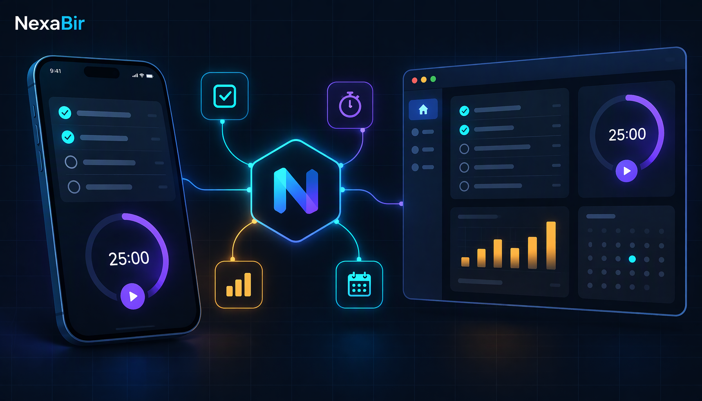

# NexaBir Productivity — portfolio demo PWA

[](#run-locally) [](sw.js) [](#demo-data-disclaimer)

A personal command-centre that fits in one offline-capable HTML file: tasks with a
kanban board, roadmap and KPI tracker, three note workspaces (document, spreadsheet,
design canvas), a focus & plan view (Pomodoro, MITs, habit streaks, meetings), a
link hub, and an activity analytics dashboard — all persisted in `localStorage` and
served through a cache-versioned service worker. Vanilla JS, no framework, no
backend, no build step. Dark-first design system (Fira Sans / Fira Code, blue +
amber), installable via web manifest.



## Quick start

```bash
npx serve .                        # or: python -m http.server 5173
# open http://localhost:5173  (serving over http(s) enables install + SW)
```

Double-clicking `index.html` also works — the service worker simply stays inactive.

## Features

* **Views** — Dashboard (KPIs + charts), Tasks, Board, Roadmap, Focus & Plan, Links, Notes, KPI tracker.
* **Tasks** — statuses, priorities, projects, sprints, sub-steps, comments, assignees; list / kanban / timeline over one model.
* **Notes** — rich-text document editor, spreadsheet grid, freeform design canvas.
* **Focus & Plan** — Pomodoro timer with work/break modes, daily MITs, habit streaks, meeting planner.
* **Analytics** — sessions-per-day, hour-of-day, model and agent charts from a snapshot feed.
* **Offline PWA** — `manifest.webmanifest` + `sw.js` (cache v3, old caches purged on activate).
* **Dark + light theme** with persistent preference and matching `theme-color`.

## Demo data disclaimer

This portfolio copy runs entirely on **synthetic data**: fictional team members,
invented tasks, notes and a generated analytics snapshot (`data/analytics.js`,
`data/opencode.json`). No real person, organisation, session log or metric is
shown. Your edits are stored only in your browser's `localStorage` (key
`nexabirProd.v1`).

## Files

```
index.html             the whole app (inline CSS + JS)
manifest.webmanifest   install metadata
sw.js                  service worker (cache "nexabir-productivity-v3")
data/analytics.js      synthetic activity snapshot
data/opencode.json     synthetic session export
icons/                 PWA icons (180 / 192 / 512)
```

## Deploy

Any static host: import the repo into Vercel with Framework Preset **Other** — no
build command, root directory is the repo root. Keep the files at the same relative
paths so the service worker scope and manifest stay valid.

MIT — sample portfolio project. Built by Abir.
